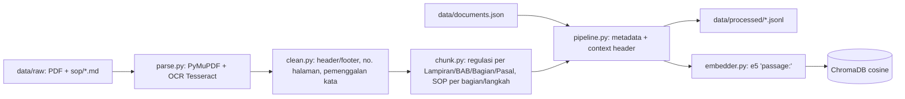
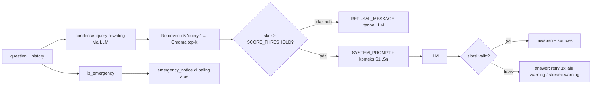

# Arsitektur — Level 2

Dokumen ini menjelaskan kondisi **Level 2 saat ini** (vector search saja, tanpa BM25/reranker). Rencana Level 3 ada di `ROADMAP.md`.

## Ingestion (offline)



- OCR otomatis bila teks halaman < `OCR_MIN_CHARS`. `page_range` di registry membatasi halaman PDF.
- Chunk panjang dipecah sliding window (`MAX_CHUNK_CHARS`, `CHUNK_OVERLAP`) dengan konteks induk tetap terbawa.
- Teks yang di-embed = `context_header` (judul dokumen, status DICABUT, lampiran/bab/bagian/pasal/section) + isi chunk.
- ID chunk = `sha1("<source_file>|<chunk_index>")[:16]`. Re-index per file: `delete_source` lalu `upsert`.

## Query (online)



1. `condense()` hanya berjalan bila ada `history` (maks. `HISTORY_TURNS`); bila gagal, pakai pertanyaan asli.
2. `Retriever.retrieve()` memfilter `doc_type` dan (opsional) `EXCLUDE_REVOKED`, lalu membuang hit di bawah threshold. Skor semua hit dicatat di log untuk kalibrasi.
3. `is_emergency()` dicek pada pertanyaan asli **dan** pertanyaan mandiri.
4. `_check()` menganggap jawaban valid jika ada minimal satu `[S#]` dalam rentang konteks, atau jawaban adalah penolakan.
5. Setiap jawaban menulis baris `AUDIT` ke log (pertanyaan, jumlah chunk, darurat, sitasi_ok, latency).

## Frontend Web (Next.js 15 App Router)

```mermaid
flowchart TD
  subgraph Client [Browser / Mobile Lapangan]
    UI[page.tsx + Layout]
    Store[(Zustand Store + localStorage)]
    Hook[useChatStream Hook]
    Safety[Safety UI: EmergencyBanner, CitationWarning, RefusalState]
    SourceUI[SourcePanel + CitationChip]
  end

  subgraph BFF [Next.js Route Handlers / API]
    ChatRoute[/api/chat/stream]
    ConfigRoute[/api/config]
    HealthRoute[/api/health]
    FeedbackRoute[/api/feedback]
  end

  subgraph Backend [FastAPI Service :8000]
    APIStream[/chat/stream SSE]
    APIOther[/health, /feedback]
  end

  UI --> Hook
  Hook -->|Fetch POST SSE| ChatRoute
  ChatRoute -->|Proxy SSE Stream| APIStream
  APIStream -->|SSE events: meta, token, sources, done| ChatRoute
  ChatRoute -->|ReadableStream| Hook
  Hook -->|Update tokens & state| Store
  Store --> UI
  Store --> Safety
  Store --> SourceUI
  UI --> ConfigRoute
  UI --> FeedbackRoute --> APIOther
```

- **BFF (Backend-For-Frontend) Pattern:** Route Handler Next.js mengabstraksi komunikasi backend, menangani timeout/error boundary, dan menjaga integritas streaming SSE.
- **State Management:** Zustand dengan persistence `localStorage` untuk multi-session chat, riwayat percakapan, dan caching sumber rujukan.
- **Safety-First Ergonomics:** UI kontras tinggi ramah lapangan (lapangan tambang), target sentuh $\ge 44\text{px}$, font dasar $\ge 16\text{px}$. Warna merah secara eksklusif hanya untuk keadaan darurat (`EmergencyBanner`) dan dokumen yang dicabut (`replaced_by`).
- **Validasi Runtime:** Skema payload SSE dan respons divalidasi runtime menggunakan Zod (`lib/api/schemas.ts`).

## Modul & dependency injection

| Modul | Tanggung jawab | Titik injeksi untuk test |
| --- | --- | --- |
| `config.Settings` | Semua konfigurasi dari `.env` | `Settings(score_threshold=..., ...)` |
| `retrieval.Retriever` | Embed query, query store, threshold | `Retriever(settings, embedder=, store=)` |
| `generation.RAGPipeline` | condense, prepare, answer, stream | `RAGPipeline(settings, retriever=, llm=)` |
| `generation.LLMClient` | `complete()` dan `stream()` OpenAI-compatible | ganti dengan objek ber-method sama |
| `api.main.get_pipeline` | Singleton pipeline (`lru_cache`) | monkeypatch di test API |

Komponen berat di-import lazy, sehingga test bisa berjalan tanpa `sentence-transformers`, `chromadb`, atau `openai`.

## Konfigurasi

| Grup | Variabel | Deskripsi / Penggunaan |
| --- | --- | --- |
| Path | `RAW_DIR`, `PROCESSED_DIR`, `DOC_REGISTRY`, `CHROMA_DIR`, `COLLECTION` | Lokasi file dan direktori basis data |
| Ingestion | `OCR_LANG`, `OCR_MIN_CHARS`, `MAX_CHUNK_CHARS`, `CHUNK_OVERLAP` | Ekstraksi dan pemotongan teks |
| Embedding | `EMBED_MODEL` | Model embedding (e5-large / e5-base) |
| LLM | `LLM_BASE_URL`, `LLM_API_KEY`, `LLM_MODEL` | Endpoint dan kredensial LLM |
| Retrieval & chat | `TOP_K`, `SCORE_THRESHOLD`, `EXCLUDE_REVOKED`, `HISTORY_TURNS` | Parameter pencarian konteks |
| Guardrail | `EMERGENCY_CONTACT_NAME`, `EMERGENCY_CONTACT_PHONE` | Kontak tim darurat ERT site |
| App & Web | `LOG_LEVEL`, `CORS_ORIGINS`, `BACKEND_URL`, `NEXT_PUBLIC_DEBUG_MODE` | Konfigurasi server backend dan frontend web |
